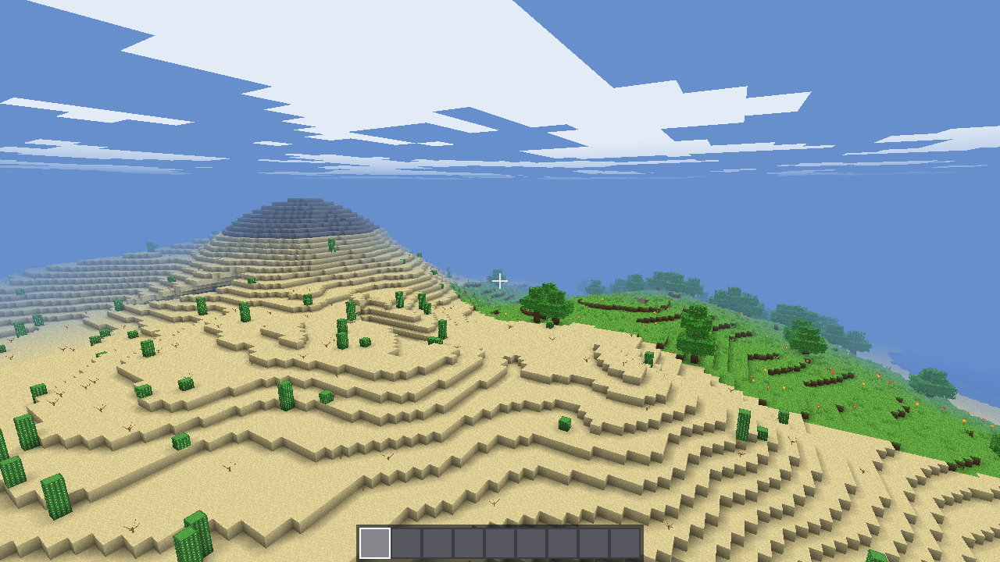
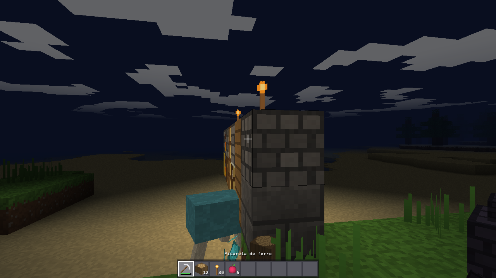

# Terralume

Jogo voxel sandbox em primeira pessoa, escrito do zero, em duas versões com as mesmas regras:

- **Web** (`web/`): JavaScript + WebGL 2, roda direto no navegador, sem instalar nada.
- **Desktop**: Java 17 + LWJGL 3 (OpenGL 3.3).

É um jogo **original do gênero** popularizado pelo Minecraft: usa as mesmas ideias de mecânica
(mundo de blocos procedural, minerar, construir, montar itens, sobreviver), mas com nome, texturas,
criaturas e visual próprios — toda a arte é gerada por código, não há nenhum arquivo de imagem ou som.




## Versão web (navegador)

A pasta `web/` contém só arquivos estáticos (`index.html` + `js/`), sem etapa de compilação.
Funciona em qualquer hospedagem comum (HostGator, etc.): basta enviar a pasta.

**Publicar na HostGator (cPanel):**

1. cPanel → **Gerenciador de Arquivos** → `public_html` → crie a pasta `terralume`.
2. Envie para ela o `index.html` e a pasta `js/` (ou envie um `.zip` com os dois e use **Extrair**).
3. Abra `https://seudominio.com.br/terralume/`.

**Testar no seu computador:** os módulos JavaScript não carregam por `file://`; sirva a pasta por HTTP:

```bash
cd web && python3 -m http.server 8000
```

e abra `http://localhost:8000/`.

Controles da versão web: **WASD** mover, **Espaço** pular/nadar, **Shift** correr, **C** agachar/descer,
botão esquerdo minerar/atacar, botão direito colocar/usar/comer, **E** inventário, **1–9**/rolagem barra,
**Q** soltar, **G** criativo, **F** voar, **H** HUD, **P** informações, **Esc** pausa.
O mundo é salvo no navegador de cada jogador (IndexedDB + localStorage); "Novo mundo" na pausa apaga e recomeça.
Parâmetros opcionais na URL: `?seed=123`, `?dist=6`, `?creative`.
Requer navegador de computador com WebGL 2, teclado e mouse (não há controles de toque).

## Versão desktop (Java)

Requisitos: JDK 17+ e Maven (placa de vídeo com OpenGL 3.3).

```bash
mvn package
```

```bash
java -jar target/terralume.jar
```

Ou use `./jogar.sh` (Linux/macOS) / `jogar.bat` (Windows). O jar inclui os nativos de Windows, Linux e macOS.

Opções: `--world NOME` (mundo salvo em `saves/NOME`), `--seed N` (semente), `--creative`, `--dist N` (distância de visão em chunks, padrão 8).

| Tecla | Ação |
|---|---|
| W A S D / mouse | andar / olhar |
| Espaço | pular, nadar (2x rápido no criativo: voar) |
| Ctrl / Shift | correr / andar devagar (descer ao voar) |
| Botão esquerdo | minerar, atacar |
| Botão direito | colocar bloco, comer, abrir bancada/fornalha |
| Botão do meio | escolher o bloco apontado |
| 1–9 / rolagem | selecionar item da barra |
| E | inventário e montagem 2x2 |
| Q | soltar item |
| F4 | alternar sobrevivência / criativo |
| F1 / F2 / F3 | esconder HUD / captura de tela / informações |
| Esc | pausar (salva ao sair) |

Primeiros passos: soque uma árvore → tronco vira tábuas → 4 tábuas viram a **bancada** →
picareta de madeira → pedra → **fornalha** (8 pedregulhos) → funda ferro. À noite surgem os Brasais no escuro: use tochas.

## Pesquisa: mecânicas do gênero e o que foi implementado

| Sistema | Como funciona no gênero | Terralume |
|---|---|---|
| Mundo | Blocos cúbicos em chunks, gerados sob demanda por ruído a partir de uma semente | Chunks 16×128×16 infinitos, geração em threads, descarregamento e salvamento em disco |
| Relevo e biomas | Ruído fractal para continentes/montanhas; temperatura e umidade escolhem o bioma | Planície, floresta, deserto, tundra, montanha, praias e mares |
| Cavernas e minérios | Ruído 3D escava túneis; veios por profundidade | Túneis "espaguete", carvão, ferro, ouro e cristal por faixa de altura |
| Vegetação | Árvores e plantas espalhadas por bioma | Carvalhos, pinheiros, capim, flores, cactos, arbustos (sem costura entre chunks) |
| Renderização | Malha por chunk com faces ocultas removidas, atlas de texturas | Idem, mais oclusão de ambiente e luz suave por vértice, névoa, recorte por frustum |
| Iluminação | Luz do céu e de blocos (0–15) propagada por inundação | Implementada com adição/remoção incremental; tochas, lampião e fornalha acesa emitem luz |
| Céu | Ciclo dia/noite, sol, lua, nuvens | Dia de 20 min, sol/lua, nuvens, crepúsculo, visão subaquática |
| Física | Caixa de colisão, gravidade, pulo, natação, dano de queda | Implementado; areia e cascalho caem; plantas quebram sem apoio |
| Minerar/construir | Tempo de quebra por dureza e ferramenta; raio para escolher bloco | Implementado, com níveis de ferramenta, desgaste e animação de rachadura |
| Inventário e montagem | 36 espaços, grade 2×2 e bancada 3×3, receitas com formato | Implementado (32 receitas), fornalha com combustível |
| Sobrevivência | Vida, fome, fôlego, regeneração, morte e renascimento | Implementado |
| Criaturas | Animais pacíficos e monstros que surgem no escuro | Lanudo (pacífico, dá carne) e Brasal (hostil, se desfaz ao sol) |
| Modos | Sobrevivência e criativo | Ambos (F4), com voo e paleta de todos os itens |
| Líquidos | Água/lava escorrem em níveis | Simplificado: água só inunda cavidades abaixo do nível do mar; sem lava |

**Fora do escopo desta versão:** som, multijogador, circuitos lógicos, agricultura, encantamentos, vilas,
outras dimensões, portas/escadas/meios-blocos, baús, armaduras e modelo da mão em primeira pessoa.

## Código

A versão web (`web/js/`) espelha a versão Java módulo a módulo (`game`, `world`, `worldgen`, `mesher`,
`entity`, `blocks`, `atlas`, `ui`, `gfx`), com a geração de chunks em Web Workers (`genworker`).

`src/main/java/terralume/`

- `Game` — janela, laço principal, entrada, sobrevivência e renderização do mundo
- `World` — chunks, iluminação, edição de blocos, água, fornalhas, salvamento
- `WorldGen`, `Noise` — geração procedural
- `ChunkMesher` — malhas com oclusão de ambiente
- `Entity` — física, jogador, criaturas e itens soltos
- `Block`, `Item`, `Recipes` — conteúdo do jogo
- `Atlas` — texturas desenhadas por código
- `Ui`, `Gfx` — interface, shaders, fonte
- `SelfTest` — testes das regras sem janela

```bash
java -cp target/terralume.jar terralume.SelfTest
```
